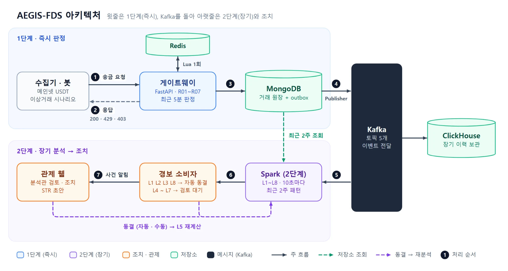
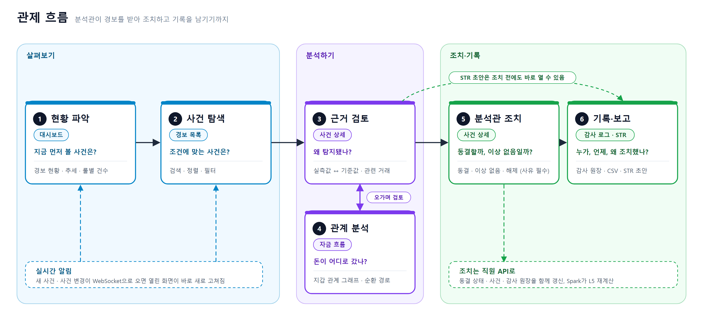
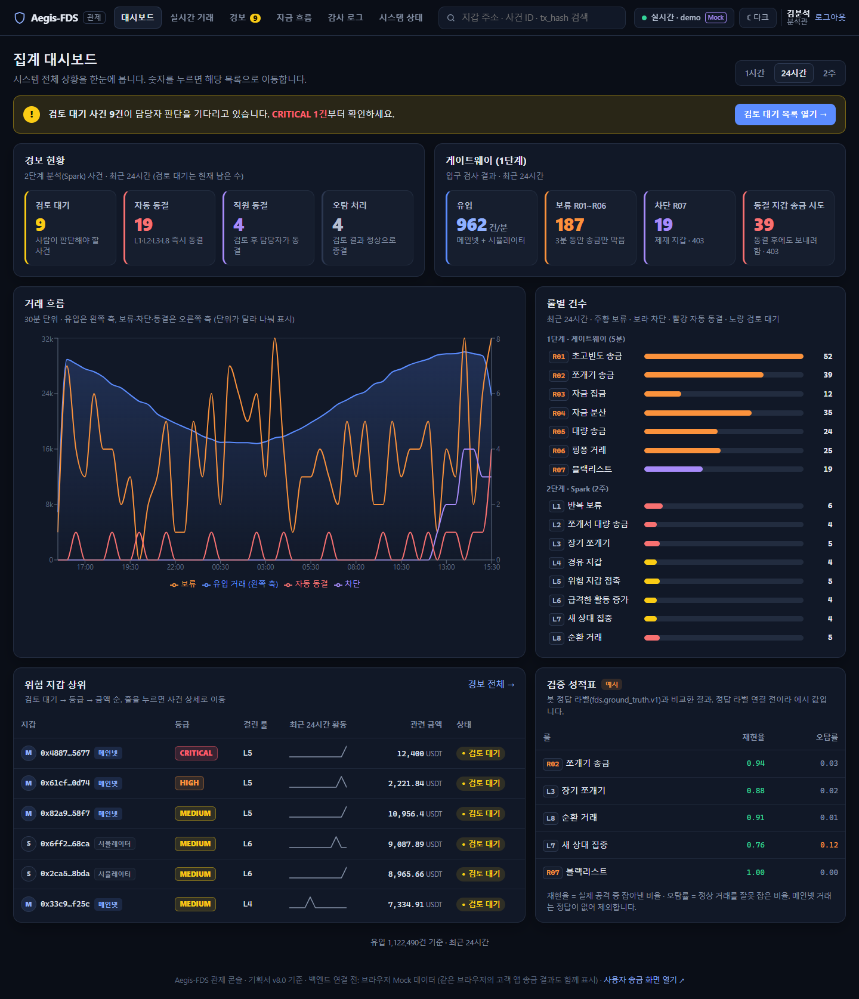
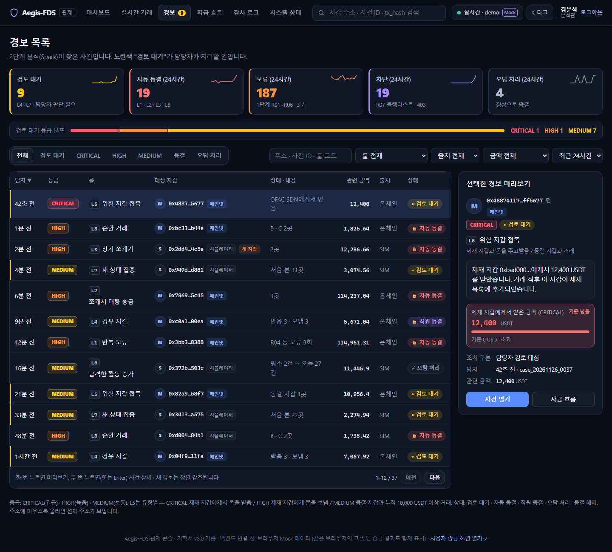
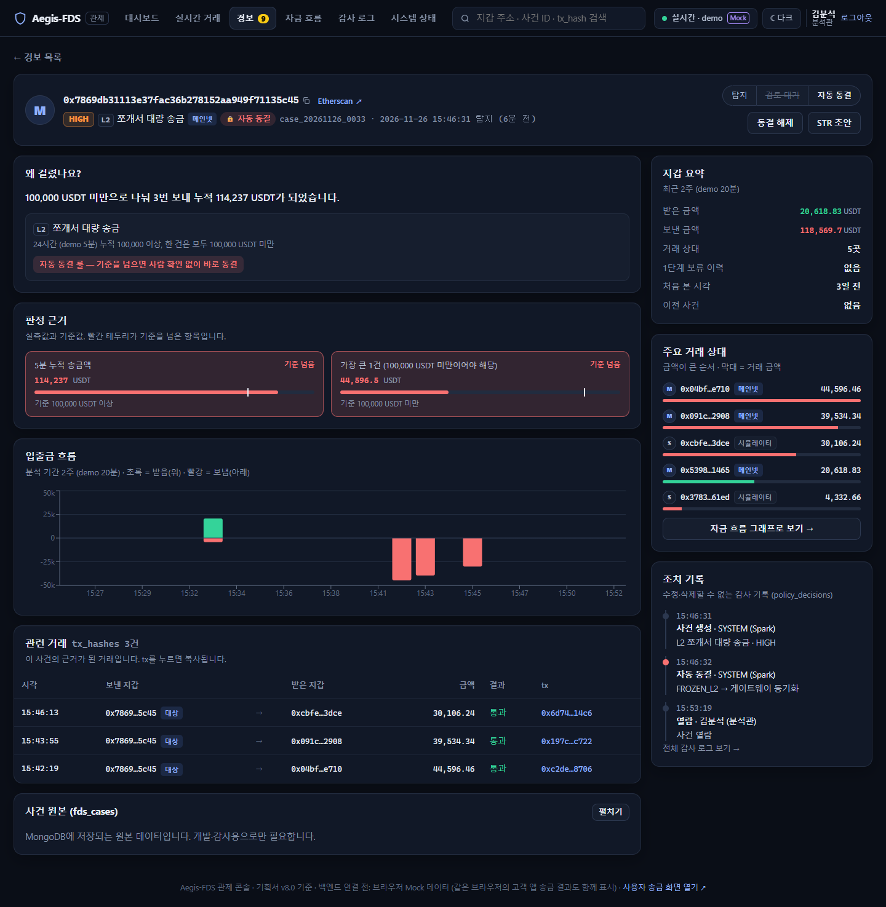
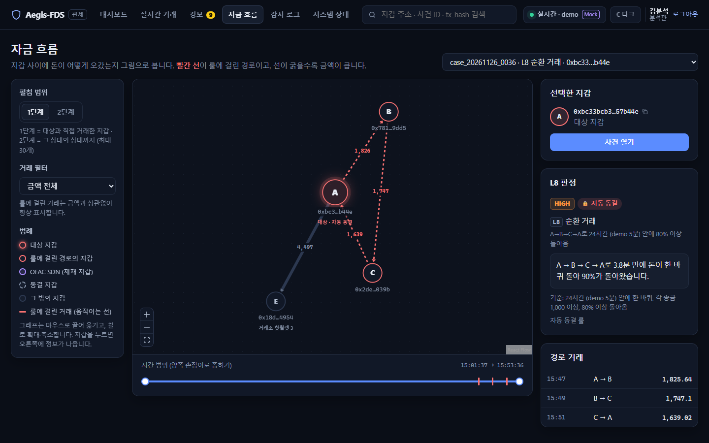
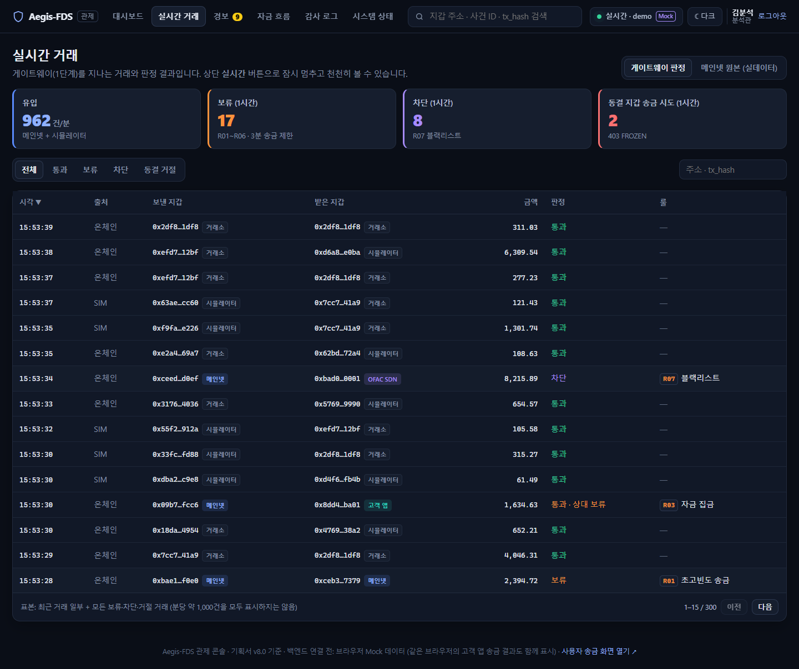
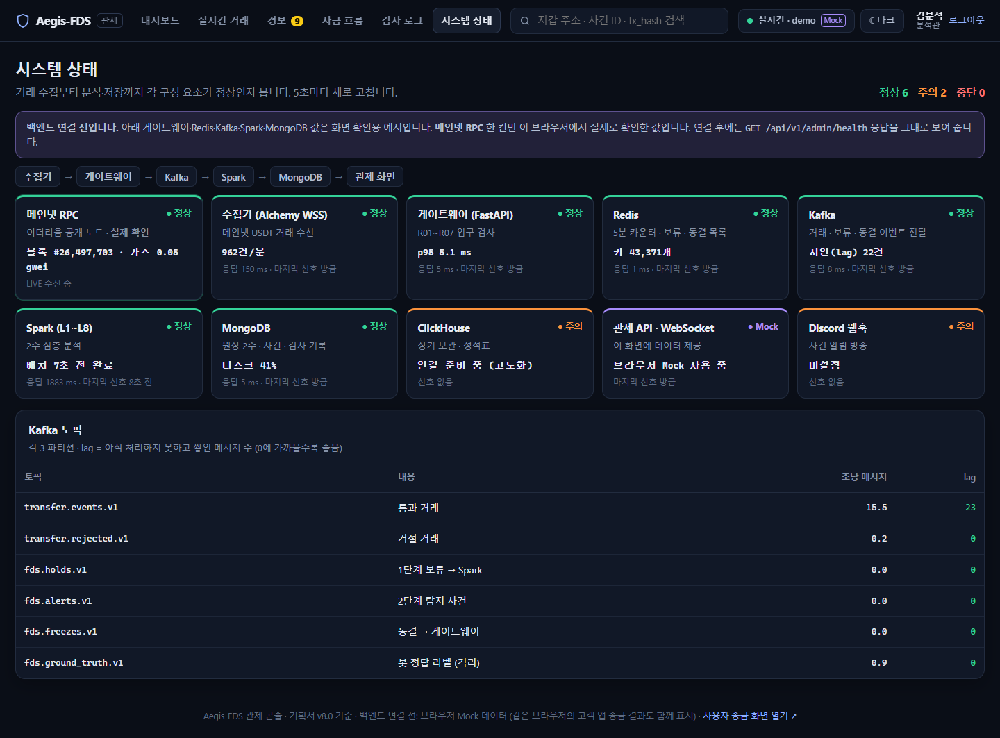
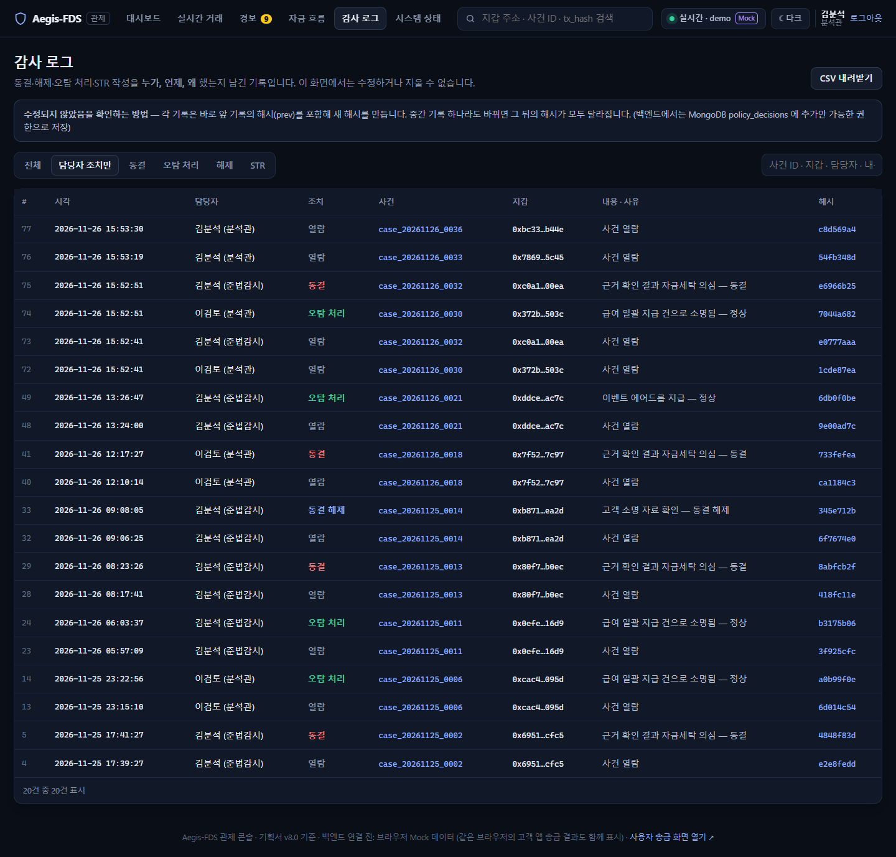
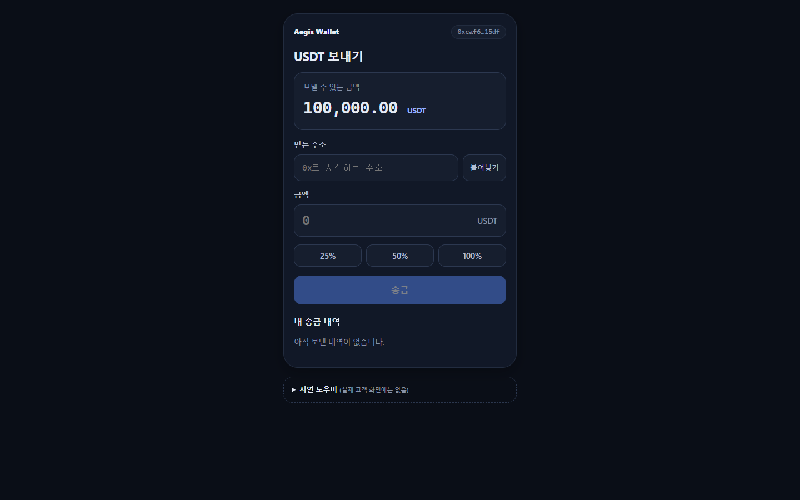

# AEGIS-FDS

USDT 송금에서 이상거래를 실시간으로 찾아 지갑을 보류·동결하는 이상거래 탐지 시스템(FDS)

---

## 목차

1. [개요](#1-개요)
   - [1-1 프로젝트 소개](#1-1-프로젝트-소개)
   - [1-2 팀 구성과 역할](#1-2-팀-구성과-역할)
   - [1-3 저장소 구성](#1-3-저장소-구성)
   - [1-4 사용한 데이터와 출처](#1-4-사용한-데이터와-출처)
2. [메인](#2-메인)
   - [2-1 아키텍처와 기술 스택](#2-1-아키텍처와-기술-스택)
   - [2-2 관리자 대시보드](#2-2-관리자-대시보드)
   - [2-3 안정성 검증 (지연 이벤트 · 장애 복구 · 장기 가동)](#2-3-안정성-검증)
3. [마무리](#3-마무리)
   - [3-1 프로젝트의 목적과 기대 효과](#3-1-프로젝트의-목적과-기대-효과)
   - [3-2 한계와 발전 가능성](#3-2-한계와-발전-가능성)
4. [부록: 실행 방법 · 문서 모음](#4-부록)

---

## 1. 개요

### 1-1 프로젝트 소개

스테이블코인 USDT는 송금이 빠르고 국경이 없어 쪼개기 송금, 자금 분산·집금, 순환 거래 같은 자금세탁 수법에 자주 쓰인다.
AEGIS-FDS는 이더리움 메인넷 USDT 거래와 시뮬레이터 봇 거래를 게이트웨이로 받아 **두 단계로 검사**한다.

| 단계 | 어디서 | 무엇을 보나 | 결과 |
|---|---|---|---|
| 1단계 (즉시) | 게이트웨이 + Redis | 거래 시각 기준 최근 5분, 룰 R01~R07 | 3분 보류(429) 또는 차단(403) |
| 2단계 (장기) | Spark, 10초마다 | MongoDB 최근 2주 기록, 룰 L1~L8 | 자동 동결 또는 분석관 검토 대기 |

- 1단계는 빠르게 막고, 2단계는 오래 지켜봐야 보이는 패턴(쪼개서 대량 송금, 경유 지갑, 순환 거래)을 찾는다.
- 분석관은 관리자 대시보드에서 사건 근거를 보고 동결·이상 없음·해제를 처리하고, STR(의심거래보고) 초안을 만든다.
- 보류·동결은 **송금만** 막는다. 실제 자산은 이동하지 않는다.

### 1-2 팀 구성과 역할

| 이름 | 역할 | 담당 |
|---|---|---|
| 백선영 | INFRA · 아키텍트 · PM | 전체 설계·일정, 배포(`deploy/`), compose, 수집기(`collector/`) |
| 황유민 | DE · BE | 탐지 룰 기반 전체 기능 구현/ 데이터베이스 설계, Publisher·경보 소비자, 게이트웨이·직원 API(`fds/`) |
| 박은서, 장기욱 | FE | React 기반 송금·관제 웹(web/), 송금 UI, 관리자 대시보드, 거래·사건 관리, 자금 흐름 시각화, 통계 분석, FastAPI·WebSocket 연동(`web/`) |


### 1-3 저장소 구성

```text
aegis-fds/
├─ fds/                  탐지 백엔드
│  ├─ app/               게이트웨이(FastAPI)·직원 API·Publisher·경보 소비자
│  ├─ spark/             Spark 2단계 탐지 (L1~L8, 재계산, 경보 outbox)
│  ├─ common/            서비스 공용 값 (토픽 이름, Redis 키, R05 기준)
│  └─ clickhouse/        ClickHouse 테이블 (Kafka 엔진으로 토픽 적재)
├─ web/                  관제 웹 (React + Vite) — 사용자 송금 화면 / 관리자 대시보드
├─ collector/            메인넷 USDT 수집기 (Alchemy WebSocket)
├─ bots/                 이상거래 시나리오 봇, 실데이터 혼합 실행
├─ deploy/
│  ├─ aws/               AWS EC2 배포 (CloudFormation, 배포·침지 테스트 스크립트)
│  ├─ k3s/               k3s 매니페스트, 이미지 넣기, 무중단 재시작 시험
│  └─ data/              데이터 노드(Redis·Mongo·Kafka·ClickHouse) 분리용 compose
├─ scripts/              오프라인 검사 (금액 기준, 봇 혼합 비율, 리플레이 입력)
├─ docs/                 API 명세, 테스트·데이터 보고서, 검증 캡처
└─ docker-compose.yml    로컬 전체 실행
```

| 폴더 | 자세한 안내 |
|---|---|
| 탐지 백엔드 | [`fds/README.md`](fds/README.md) — 검사 순서, 룰 기준값, 직원 API, 저장소, 운영 명령 |
| 관제 웹 | [`web/README.md`](web/README.md), 사용자 매뉴얼 [`web/docs/manual.html`](web/docs/manual.html) |
| 수집기 | [`collector/README.md`](collector/README.md) |
| 봇 | [`bots/README.md`](bots/README.md) |
| AWS 배포 | [`deploy/aws/README.md`](deploy/aws/README.md) |
| API 명세 | [`docs/API_SPECIFICATION.md`](docs/API_SPECIFICATION.md) |

### 1-4 사용한 데이터와 출처

| 데이터 | 출처 | 내용 |
|---|---|---|
| 메인넷 실거래 | 이더리움 메인넷 USDT(ERC-20) 컨트랙트 `0xdac17f958d2ee523a2206206994597c13d831ec7`의 `Transfer` 이벤트, Alchemy WebSocket으로 실시간 구독 | 거래 해시, 보낸·받은 주소, 금액, 블록, 시각 |
| 시뮬레이터 봇 | `bots/run_bots.py` 시나리오 16개 (주소는 모두 `BOT-` 접두어) | 룰마다 걸리도록 만든 이상거래 + 정상 거래. 실거래와 1:1 비율로 섞어 보냄 |
| 블랙리스트 | 직원 API로 등록한 주소 | R07 차단, L5 위험 지갑 접촉 판단에 사용 |

31시간 녹화 데이터 통계 ([`docs/DATASET_31H_STATISTICS_REPORT.md`](docs/DATASET_31H_STATISTICS_REPORT.md)):

| 항목 | 값 |
|---|---|
| 수집 구간 | 2026-11-18 12:46 ~ 11-19 19:40 UTC (약 31시간) |
| 총 거래 | 860,031건 (평균 초당 7.7건) |
| 0원 스팸 (주소 오염 피싱) | 50,178건 (5.83%) — 탐지 파이프라인에 넣지 않음 (게이트웨이는 0원을 422로 거절) |
| 실제 자산 이동 | 809,853건, 약 200억 USDT |
| 금액 중앙값 / p99 | 100.14 USDT / 약 240,000 USDT |
| 고유 송신 / 수신 지갑 | 232,807개 / 266,309개 |

녹화 원본(JSONL)과 DB는 크기·개인정보 문제로 Git에 올리지 않는다. 11/19 메인넷 실데이터 E2E 검증 캡처는 [`docs/evidence/20261119/`](docs/evidence/20261119/README.md)에 있다.

---

## 2. 메인

### 2-1 아키텍처와 기술 스택

#### 동작 흐름



- 게이트웨이는 거래와 Kafka 전송 대기분(outbox)을 Mongo에 **같이** 저장하고, Publisher가 따로 보낸다. Kafka가 잠시 죽어도 거래가 빠지지 않는다.
- Spark는 Kafka 메시지를 "누구를 분석할지" 고르는 데만 쓰고, 계산은 Mongo의 거래 시각 기준 기록으로 한다. 늦게 들어온 거래도 같은 결과가 나온다.
- 동결 이벤트가 다시 Spark로 돌아가, 동결 지갑과 거래한 상대(L5)를 다시 본다.

#### 탐지 룰

##### ① 송금 순간에 막는다 — 1단계 (최근 5분)

게이트웨이가 송금 요청을 받는 순간 Redis로 판단한다. "보류"는 그 지갑의 **송금만 3분 동안 멈추는 것**이고, 입금은 계속 받는다.

| 룰 | 이름 | 이런 송금을 잡습니다 | 결과 |
|---|---|---|---|
| R01 | 초고빈도 | 5분 안에 5건 이상 송금 | 보류 |
| **R02** | **쪼개기** | **900~990 USDT를 5분 안에 3번** (1,000달러 기준 피하기) | **보류** |
| R03 | 집금 | 서로 다른 5곳에서 한 지갑으로 입금 | 받는 지갑 보류 |
| R04 | 분산 | 한 지갑이 서로 다른 5곳으로 송금 | 보류 |
| R05 | 대량 | 1건 100,000 USDT 이상 | 보류 |
| R06 | 핑퐁 | A→B 보낸 뒤 5분 안에 B→A | 받는 지갑(A) 보류 |
| R07 | 블랙리스트 | 제재 지갑과 거래 (보내거나 받거나) | 차단 (면제 없음) |

- 보류: 이번 송금은 429로 거절, 보낸 지갑 3분 보류. "받는 지갑 보류"는 이번 송금은 통과시키고 돈이 모인 지갑을 묶는다.
- 시간은 도착 시각이 아니라 **거래 시각** 기준이다. 거래소처럼 정상적으로 많이 보내는 지갑은 룰별 화이트리스트로 면제한다 (R07은 면제 없음).

##### ② 쌓인 패턴으로 잡는다 — 2단계 (최근 2주)

한 건만 보면 정상인 거래도 오래 모아 보면 드러난다. Spark가 10초마다 최근 2주 기록을 다시 계산한다.

| 룰 | 이름 | 이런 패턴을 잡습니다 | 조치 |
|---|---|---|---|
| L1 | 반복 보류 | 1단계 보류가 3번 이상 반복 | 자동 동결 |
| L2 | 쪼개서 대량 송금 | 하루 합계 100,000 이상인데, 한 건은 모두 그보다 작음 | 자동 동결 |
| L3 | 장기 쪼개기 | 900~990 송금 10회 이상 | 자동 동결 |
| L4 | 경유 지갑 | 1,000 이상 받고 1시간 안에 80% 이상 다시 보냄 (3회 이상) | 검토 대기 |
| L5 | 위험 지갑 접촉 | 제재·동결 지갑과 거래 | 검토 대기 |
| L6 | 활동 급증 | 평소의 10배 이상 송금 (최소 20건) | 검토 대기 |
| L7 | 새 상대 집중 | 하루에 처음 보는 상대 20곳 이상 | 검토 대기 |
| **L8** | **순환 거래** | **A→B→C→A로 돈의 80% 이상이 돌아옴** | **자동 동결 (CRITICAL)** |

- 자동 동결: 사람 확인 없이 바로 동결하고 사건을 만든다. 검토 대기: 분석관이 근거를 보고 동결 또는 이상 없음으로 처리한다.
- 위험도: L8은 의도가 가장 분명해 CRITICAL, 나머지 자동 동결은 HIGH, 검토 대기는 MEDIUM. L5는 제재 지갑에게서 받으면 CRITICAL, 보내면 HIGH, 동결 지갑과 1만 USDT 이상 주고받으면 MEDIUM.
- 기간은 운영(`prod`) 2주 / 24시간 / 1시간, 시연(`demo`) 20분 / 5분 / 1분이다. 로컬 compose는 `demo`로 돈다.
- L2·L6·L7 경보는 원본 거래를 Spark DataFrame으로 다시 계산해(1분 내역, 5분 이동 윈도 `window()`) 판정 값과 맞는지 근거로 붙인다.
- 정확한 기준과 예외(화이트리스트, 해제 후 재분석)는 [`fds/README.md`](fds/README.md#2단계-룰)에 있다.

#### 역할별 기술 스택

| 영역 | 역할 | 기술 |
|---|---|---|
| **수집** | 메인넷 USDT 실시간 구독, 이상거래 봇 |    |
| **백엔드 · 1단계** | 송금 API, R01~R07 즉시 판정, 직원 API |    |
| **메시지** | 서비스 사이 이벤트 전달 · 재처리 |  |
| **스트리밍 · 2단계** | 10초 배치 L1~L8, 근거 재계산 |   |
| **저장** | 원장 · 사건 · 감사 / 장기 분석 이력 |    |
| **프론트** | 관리자 대시보드, 사용자 송금 화면 ([2-2](#2-2-관리자-대시보드)) |       |
| **배포 · 운영** | 로컬 · 클라우드 배포, 모니터링 |       |

버전: Python 3.12 · FastAPI 0.115 · Kafka 4.3 (KRaft, 브로커 1대) · Spark 3.5.7 · Redis 7.4 · MongoDB 7.0 (replica set `rs0`) · ClickHouse 25.8 · React 19 · Vite 8

#### 데이터 저장 구조

| 저장소 | 이름 | 내용 |
|---|---|---|
| Mongo | `transfers` | 모든 송금 요청 원본 (통과·거절) |
| Mongo | `fds_holds` | 1단계 보류 기록 (지갑, 룰, 근거). 14일 보관 |
| Mongo | `outbox_events` | 게이트웨이 → Kafka 전송 대기함 |
| Mongo | `fds_alert_outbox` | Spark → Kafka 경보 전송 대기함 (`PENDING` → `PUBLISHED`). 7일 보관 |
| Mongo | `fds_cases` | L1~L8 사건 (자동 동결 / 검토 대기, 증거, 기준값, 재계산 근거, 처리 기록) |
| Mongo | `policy_decisions` | 감사 원장 — 자동 동결·직원 조치·리스트 변경·STR 저장을 한 줄씩 쌓기만 함 |
| Mongo | `fds_blacklist`, `fds_whitelist` | 리스트 등록·해제 이력 (지우지 않고 `active: false`) |
| Redis | `fds:w:*` | 1단계 5분 기록 (점수 = 거래 시각) |
| Redis | `fds:hold:*`, `fds:frozen_*`, `fds:blacklist_wallets`, `fds:whitelist:*` | 보류(3분), 동결·사유, 블랙리스트, 룰별 면제 |
| Redis | `fds:analyzed:*`, `fds:analyze_pending`, `fds:recheck_l5` | Spark 재분석 간격, 미룬 지갑, L5 재계산 대기 |
| ClickHouse | `transfers`, `holds`, `alerts`, `freezes` | 토픽별 장기 이력 ([`fds/clickhouse/`](fds/clickhouse)) |

키 전체 목록은 [`fds/README.md`](fds/README.md#저장소)에 있다.

#### Kafka 토픽

| 토픽 | 보내는 쪽 | 받는 쪽 | 역할 |
|---|---|---|---|
| `transfer.events.v1` | 게이트웨이(Publisher) | Spark, ClickHouse | 통과한 거래 → 보낸·받은 지갑 분석 계기 |
| `transfer.rejected.v1` | 게이트웨이(Publisher) | ClickHouse | 거절된 요청 장기 보관 (Spark는 읽지 않음) |
| `fds.holds.v1` | 게이트웨이(Publisher) | Spark, ClickHouse | 1단계 보류(HOLD)·R07 차단(BLOCK) → 보류 지갑 분석 계기 |
| `fds.alerts.v1` | Spark | 경보 소비자, ClickHouse | L1~L8 경보 (경보 번호 `alert_id` 포함) |
| `fds.freezes.v1` | 경보 소비자, 직원 API | Spark, ClickHouse | 동결(FREEZE)·해제(UNFREEZE) → 상대 지갑 L5 재계산 계기 |

- 토픽 이름은 `fds/common/keys.py` 한 곳에서 정하고 모든 서비스가 같이 쓴다.
- 같은 지갑의 메시지는 지갑 주소를 key로 보내 순서가 유지된다.

### 2-2 관리자 대시보드

React + Vite로 만든 관제 콘솔이다. 게이트웨이의 직원 API와 WebSocket에 붙어 경보·사건·거래를 보여 주고, 분석관이 판단과 조치를 한 화면에서 끝낸다.

| 🔎 사건 탐색 | 📊 근거 확인 | 🔗 자금 흐름 | 📝 대응·보고 |
|:---:|:---:|:---:|:---:|
| 조건 검색·정렬·필터 | 실측값과 기준값 비교 | 지갑·거래 관계 시각화 | 분석관 조치·STR 초안 |

| 주소 | 화면 | 대상 |
|---|---|---|
| `/` | 사용자 송금 화면 (로그인 없음) | 고객. 결과만 쉬운 말로 안내, 룰 코드는 보여 주지 않음 |
| `/admin/` | 관리자 대시보드 (로그인 필요) | 분석관 (분석관 / 조회 전용 권한) |

#### 관제 흐름



#### 화면

> 아래 캡처는 Mock 데이터(예시) 기준이다. 실제 백엔드 연결 화면은 `docs/images/screens/live/`에 있다.

| 대시보드 | 경보 목록 |
|---|---|
|  |  |

| 사건 상세 | 자금 흐름 (L8 순환 거래) |
|---|---|
|  |  |

| 실시간 거래 | 시스템 상태 |
|---|---|
|  |  |

| 감사 로그 | 사용자 송금 화면 |
|---|---|
|  |  |

#### 화면 구성

| 화면 | 경로 | 하는 일 | 분석관이 확인하는 것 | 주로 쓴 기술 |
|---|---|---|---|---|
| 대시보드 | `#/` | 경보 현황, 게이트웨이(1단계) 처리, 거래 흐름 추세, 룰별 건수, 위험 지갑 상위, 봇 검증 성적표. 지표를 누르면 해당 목록으로 이동 | 지금 먼저 검토할 사건은 무엇인가? | Recharts |
| 경보 목록 | `#/alerts` | 사건을 룰·상태·출처·금액·기간·지갑 주소로 검색·정렬·필터, 상세로 이동 | 특정 지갑이나 조건에 해당하는 사건은 무엇인가? | TanStack Table |
| 사건 상세 | `#/cases/{id}` | 판정 근거(거래 값과 기준값 비교), 관련 거래·지갑 요약, 동결·이상 없음·해제 조치, STR 초안 조회·다운로드·분석관 의견 저장 | 왜 탐지됐고, 어떤 대응이 필요한가? | Recharts |
| 자금 흐름 | `#/flow/{id}` | 송신·수신 지갑 관계 그래프, 순환(A→B→C) 경로, 1·2단계 관계·시간·금액 필터 (화면을 열 때만 불러옴, `React.lazy`) | 자금이 어느 지갑으로 이동했는가? | React Flow |
| 실시간 거래 | `#/transfers` | 게이트웨이를 거친 거래 원장, 메인넷 USDT 원본 스트림 | 거래가 어떤 결과로 처리됐는가? | TanStack Table |
| 감사 로그 | `#/audit` | 자동 동결·직원 조치·리스트 변경 이력, CSV 내려받기 | 누가, 언제, 왜 조치했는가? | - |
| 시스템 상태 | `#/system` | 서비스·Kafka 토픽 상태, Mongo ↔ ClickHouse 적재 대조 (5초마다 갱신) | 연결된 서비스는 정상인가? | - |

#### 사용 기술

| 기술 | 쓰는 곳 | 효과 |
|---|---|---|
| TanStack Table v8 | 경보 목록, 실시간 거래 | 검색·정렬·필터·페이지 나누기 |
| React Flow (`@xyflow/react`) | 자금 흐름 | 지갑 노드·연결선으로 자금 이동 경로 분석 |
| Recharts | 대시보드, 사건 상세 | 추세·유형별 통계, 근거 막대 |
| TanStack Query | 모든 서버 데이터 ([`hooks.js`](web/src/admin/data/hooks.js)) | `useQuery` 조회 캐싱, `useMutation` 조치, 성공 시 자동 재조회 |
| 공통 UI ([`ui.jsx`](web/src/admin/ui.jsx)) | 관리자 화면 전체 | 카드·KPI·상태 배지·주소·금액·근거 막대·모달 재사용 |
| Sonner | 조치 결과 | 알림 토스트 |

### 2-3 안정성 검증

#### 지연 이벤트 (늦게 도착한 거래)

| 상황 | 처리 |
|---|---|
| 거래 시각이 서버 시각과 30초 넘게 차이 | 게이트웨이가 422 `TIMESTAMP_OUT_OF_RANGE`로 거절하고 기록만 남긴다 (탐지 집계에 넣지 않음) |
| 30초 안에서 도착 순서가 뒤바뀜 | 1단계 Redis 기록의 점수가 **거래 시각**이라, 도착 순서와 관계없이 거래 시각 기준 5분으로 센다 |
| Spark가 거래를 늦게 받음 | Kafka 메시지는 분석 대상만 고르고, 계산은 Mongo에서 거래 시각 기준 기간을 다시 조회한다. 재분석 간격 안이면 대기 목록으로 미뤘다가 반드시 다시 본다 |
| Spark가 멈춘 동안 메시지가 쌓임 | 체크포인트에 기록된 Kafka 위치부터 이어 읽고, 한 배치 최대 50,000건씩 나눠 따라잡는다 |
| ClickHouse 적재가 늦음 | 시스템 상태 화면이 최근 5분은 빼고 지난 1시간의 Mongo 원장과 ClickHouse 건수를 대조한다 (99% 미만 WARN, 95% 미만 DOWN) |

#### 장애 복구

| 장애 | 설계 | 결과 |
|---|---|---|
| Redis·Mongo 장애 | 게이트웨이가 검사 없이 통과시키지 않고 503 `FDS_UNAVAILABLE` | 탐지를 건너뛴 거래가 생기지 않음 |
| Kafka 장애 | 게이트웨이 outbox(`outbox_events`), Spark 경보 outbox(`fds_alert_outbox`)에 먼저 저장 | 복구 뒤 쌓인 메시지를 다시 보냄 |
| Spark 재시작 | 체크포인트로 읽던 위치에서 이어서, 못 보낸 경보(`PENDING`)는 다음 배치에서 다시 보냄 | 경보 빠짐 없음 |
| 같은 경보가 두 번 전달 | 경보 번호(`실행ID:배치:룰:지갑`)로 사건에 한 번만 반영, 동결·감사 기록도 고유 ID로 한 번만 | 중복 사건·중복 동결 없음 |
| 체크포인트 초기화 | 경보 번호에 체크포인트 실행 ID를 넣어 예전 번호와 겹치지 않게 | 새 경보가 '이미 보낸 경보'로 버려지지 않음 |
| 게이트웨이 배포 | k3s 롤링 재시작 중 요청 실패를 세는 시험 스크립트 [`rolling_restart_test.sh`](deploy/k3s/rolling_restart_test.sh) | 무중단 배포 확인용 |

11/26 로컬 실측 (Docker Compose, 실제 L2 경보로 확인):

| 시험 | 결과 |
|---|---|
| 정상 흐름 | 경보 → 사건 → 자동 동결 → 감사 원장 1줄, Spark 재계산 값 일치 |
| 같은 경보 강제 재발송 | 사건·증거·감사 기록 변화 없음 |
| Spark 중지 중 쌓인 경보 → 재시작 | 재시작 후 전달, 사건 1개 |
| Kafka 약 50초 중지 | 경보가 `PENDING`으로 대기했다가 복구 후 전달, 사건 1개 |
| 체크포인트를 새로 잡음 (배치 번호 0부터) | 예전 경보 3,001개와 번호가 겹치는 조건에서도 새 경보가 사건·동결로 반영 |

#### 장기 가동 (AWS 25시간 침지 테스트)

[`docs/AWS_SOAK_TEST_25H_REPORT.md`](docs/AWS_SOAK_TEST_25H_REPORT.md)

- AWS EC2 단일 노드에서 메인넷 실데이터로 25시간 26분 무중단 가동, 판정 **합격**.
- 온체인 WebSocket 연결 끊김 0건, 게이트웨이 크래시 0건.
- Kafka·ClickHouse의 순간 CPU 상승을 확인하고, 그 결과를 근거로 앱 노드와 데이터 노드를 나누는 k3s 2노드 배포를 설계했다.

---

## 3. 마무리

### 3-1 프로젝트의 목적과 기대 효과

**목적**: 스테이블코인 송금에서 자금세탁 패턴을 실시간으로 막고, 분석관이 근거를 보고 빠르게 판단할 수 있는 FDS를 실데이터 규모로 만들어 보는 것.

| 기대 효과 | 내용 |
|---|---|
| 피해 확산 차단 | 1단계가 의심 지갑의 송금을 즉시 3분 보류해 자금이 빠져나가기 전에 시간을 번다 |
| 장기 패턴 탐지 | 한 건만 보면 정상인 거래도 2주 기록으로 쪼개기·경유·순환을 찾아낸다 |
| 분석관 업무 단축 | 사건마다 판정 근거, 기준값, Spark 재계산, 자금 흐름 그래프, STR 초안을 한 화면에 모아 준다 |
| 감사 추적 | 자동 동결과 직원 조치가 모두 사유와 함께 감사 원장에 남는다 |
| 운영 신뢰성 | outbox·중복 방지·체크포인트로 장애가 나도 경보가 빠지거나 두 번 반영되지 않는다 |
| 실데이터 검증 | 메인넷 86만 건 규모에서 25시간 무중단 가동을 확인했다 |

### 3-2 한계와 발전 가능성

#### ① 데이터의 한계

**1. 잔액을 모른다**

수집하는 USDT Transfer 이벤트에는 보낸 주소·받은 주소·금액·시각만 있다

- 가져올 수 있는 데이터가 계좌에 남은 잔액을 모르기 때문에 잔액 대비 룰을 만들 수 없었다.
그래서 본 프로젝트 내에서는 대량 송금(R05) 같은 룰을 고정값으로 넣었다.

> **발전 방향** : 잔액을 함께 조회해 가져올 수 있다면 룰을 조금 더 발전 시킬 수 있다. 잔액의 90퍼센트 이상 인출시 등

**2. 이미 확정된 거래다**

온체인 송금은 블록에 들어간 뒤에야 받는다

- 본 프로젝트는 확정된 거래를 출금 요청으로 가정해 게이트웨이에 다시 흘려 판정·응답·기록 경로를 검증했다.

> **발전 방향** : 프로젝트 내에서는 가져올 수 있는 데이터의 한계가 있지만 만약 실 운영이 가능하다면 출금 앞단에 게이트웨이를 배치해 실제 거래 전에 보류 차단이 가능함

**3. 실데이터에는 정답이 없다**

- 프로젝트 내에서 사용한 봇 데이터는 "얼마나 보류 및 동결 되어야 정상" 이라는 정보가 있지만 실 데이터에는 사실상 그런게 없다.

> **발전 방향** : 본 프로젝트에서 장기 기록을 ClickHouse에 보관하는데 많은 데이터가 쌓이면 데이터를 통계 및 분석하여 이상 패턴의 분포와 변화, 오탐 추세를 분석해 새로운 수법을 찾을 수 있다

---

#### ② 탐지 시스템의 한계

**1. 고정 기준값이라 피해 갈 수 있다**

100,000USDT 기준 99,999 USDT, 5분에 5건 기준 4건처럼 기준 바로 아래로 맞추면 걸리지 않는다

- 탐지 룰에서 사용한 기준은 대부분 기준이 고정값이다. 만약 이 값이 유출된다면 100,000USDT 이상을 99,999USDT로 회피 가능

> **발전 방향** : 지갑 잔액을 가져올 수 있다면 보유금액 대비 퍼센트와 고정 금액을 함께 기준으로 사용하고 기준 바로 아래(10% 정도) 에 몰리는 송금을 따로 감시하고, 평소 대비 이상 점수를 보조로 붙인다

**2. 장기 분석의 부재**

- 지금은 데이터가 2주간 MongoDB 에 보관되고 그 데이터에 대한 분석만 이루어진다.

> **발전 방향** : 장기적으로 데이터를 받아 돌려본 후 ClickHouse 로 보관된 장기보관 데이터를 활용하여 분석하고 새로운 범죄수법 탐지 및 룰 제작, 시스템의 허점 탐색

**3. 데이터 복구 기능 부재**

- 만약 MongoDB의 데이터나 Redis의 데이터 ClickHouse 의 데이터 등등 오류로 인해 사라져 버린다면 바로 복구할 수 있도록 설계가 안되어있음

> **발전 방향** : Mongo 3대 replica set 생성과 정기 백업, Redis 복제. 동결 상태는 ClickHouse의 동결 이벤트나 Mongo 기록으로 다시 만들 수 있게 하고, ClickHouse는 외부 저장소(S3 등)에 따로 백업

---

#### ③ 관제 웹의 한계 (실시간 갱신)

**1. WebSocket 자동 재연결이 없다**

- 연결이 끊기면(게이트웨이 재시작 등) 알림이 조용히 멈추고, 화면을 새로 고쳐야 다시 붙는다. 창 전환 시 재조회도 꺼져 있어 그동안 화면이 갱신되지 않는다 (시스템 상태만 5초마다 갱신)

> **발전 방향** : 끊기면 간격을 늘려 가며 다시 연결하고, 다시 붙을 때 전체 재조회. 화면에 연결 상태 표시

---

#### 총정리

AEGIS-FDS는 이더리움 메인넷 USDT 실거래 위에서 **"송금 순간에 막는 1단계"와 "쌓인 패턴으로 잡는 2단계"가 하나의 흐름으로 동작함**을 확인한 프로젝트이다. 수집 → 게이트웨이 판정 → Kafka 전달 → Spark 장기 분석 → 사건 생성·자동 동결 → 관제 화면의 조치·STR 초안까지 끊기지 않고 이어졌고, AWS에서 25시간 무중단 가동과 장애 상황(Kafka·Spark 중지, 같은 경보 재전송)에서도 경보가 빠지거나 두 번 반영되지 않음을 확인했다.

남은 한계는 세 가지로 정리된다.

- **데이터**: 잔액·정답 라벨·실제 출금 연결이 없어 룰을 고정 기준으로 만들었고, 실제 차단이 아니라 "막았다면 이렇게 판정했다"까지만 검증했다.
- **탐지·시스템**: 고정 기준은 회피할 여지가 있고, 분석은 최근 2주에 머물며, 백업·복제가 없어 장애 시 복구 수단이 부족하다.
- **관제 웹**: 실시간 연결이 끊기면 스스로 다시 붙지 않는다.

이 한계 대부분은 기능보단 **데이터와 운영 환경**의 문제라, 조건이 갖춰지면 지금 구조 위에서 이어서 풀 수 있다. 잔액 조회와 출금 앞단 연동이 붙으면 실제로 막는 FDS가 되고, ClickHouse에 쌓이는 장기 이력과 분석관의 처리 결과가 모이면 기준값을 데이터로 조정하고 새로운 수법을 찾아 룰로 만드는 방향으로 발전할 수 있다.

---

## 4. 부록

### 로컬 실행

필요한 것: Docker Desktop, Python 3.12 (봇·수집기), Node.js 20.19 이상 (관제 웹). 명령은 저장소 맨 위 폴더에서 실행한다.

**1. `.env` 만들기** — `.env.example`을 `.env`로 복사하고 값을 채운다. `.env`는 Git에 올리지 않는다.

| 키 | 필수 | 내용 |
|---|---|---|
| `GATEWAY_API_KEY` | 예 | 송금 API 키. 없으면 게이트웨이가 시작하지 않는다 |
| `ADMIN_API_KEY` | 관제 웹 쓸 때 | 직원 API 키 (송금 키와 다름). 비우면 직원 API만 꺼진다 |
| `CLICKHOUSE_PASSWORD` | 예 | ClickHouse 비밀번호 |
| `MONGO_URI`, `R05_LIMIT_USDT` | 기본값 사용 | 예시 파일 값 그대로 (`rs0`, 100,000) |
| `ALCHEMY_WSS_URL` | 수집기 쓸 때 | Alchemy WebSocket 주소 |
| `EVAL_ENABLED` | 선택 | 봇 정답 라벨 평가 켜기(1)/끄기(0) |

**2. Kafka 먼저 띄우고 토픽 만들기** — 자동 생성이 꺼져 있고, 토픽이 없으면 Spark가 시작하다 멈춘다. 처음 한 번만 하면 된다.

```powershell
docker compose up -d kafka
foreach ($t in "transfer.events.v1","transfer.rejected.v1","fds.holds.v1","fds.alerts.v1","fds.freezes.v1") { docker exec aegis-kafka /opt/kafka/bin/kafka-topics.sh --bootstrap-server localhost:9092 --create --if-not-exists --topic $t --partitions 3 --replication-factor 1 }
```

**3. 전체 실행** — Mongo replica set은 처음 뜰 때 알아서 설정된다.

```powershell
docker compose up -d --build
```

**4. 관제 웹**

```powershell
cd web
npm install
npm run dev
```

`http://localhost:8080/`(사용자 화면), `http://localhost:8080/admin/`(관리자 대시보드). 기본은 Mock 데이터이고, 로컬 백엔드에 붙이려면 `web/.env.local`에 `VITE_API_BASE=/`를 넣고 다시 실행한다 ([`web/README.md`](web/README.md)).

**5. 동작 확인**

```powershell
docker compose ps
curl.exe http://localhost:8000/healthz
docker logs aegis-spark --tail 30
```

- 컨테이너 8개가 모두 `Up`이면 정상. Spark 배치 로그의 `seconds`가 10초보다 충분히 짧은지 본다.
- 봇: `python bots/run_bots.py --dry-run`(계획만) → `python bots/run_bots.py --once --only L2`. 사건이 관리자 대시보드 경보 목록에 나타난다.
- 리스트 등록·동결·해제는 Redis를 직접 고치지 말고 직원 API로 한다.

| 컨테이너 | 역할 | 포트 |
|---|---|---|
| `aegis-gateway` | 송금 API, 1단계, 직원 API | `8000` (LAN, 봇 PC 접속용) |
| `aegis-publisher` | outbox → Kafka | - |
| `aegis-alert-consumer` | 경보 → 사건, 자동 동결 | - |
| `aegis-spark` | 2단계 L1~L8 | - |
| `aegis-kafka` | 메시지 전달 | 내부만 |
| `aegis-redis` / `aegis-mongo` / `aegis-clickhouse` | 저장 | `127.0.0.1` 6379 / 27017 / 8123 |

### 배포

- **AWS EC2**: [`deploy/aws/README.md`](deploy/aws/README.md)
- **k3s**: `docker compose build gateway spark` → [`deploy/k3s/import_images.sh`](deploy/k3s/import_images.sh) (수집기 이미지 포함) → `kubectl -n aegis create secret generic aegis-env --from-env-file=.env` → 매니페스트를 파일 번호 순서대로 적용 (`00` → `02` → `10`~`16`).
- `spark/`·`common/`을 고치면 로컬은 Spark 재시작만으로 반영되지만, k3s는 이미지를 다시 빌드해 넣어야 한다.

### 문서 모음

| 문서 | 내용 |
|---|---|
| [`fds/README.md`](fds/README.md) | 탐지 백엔드 상세 (검사 순서, 룰, 직원 API, 저장소, 운영 명령) |
| [`docs/API_SPECIFICATION.md`](docs/API_SPECIFICATION.md) | 관제 웹이 부르는 직원 API 명세 |
| [`docs/AWS_SOAK_TEST_25H_REPORT.md`](docs/AWS_SOAK_TEST_25H_REPORT.md) | AWS 25시간 침지 테스트 보고서 |
| [`docs/DATASET_31H_STATISTICS_REPORT.md`](docs/DATASET_31H_STATISTICS_REPORT.md) | 메인넷 31시간 실데이터 통계 |
| [`docs/evidence/20261119/`](docs/evidence/20261119/README.md) | 11/19 메인넷 E2E 검증 캡처 |
| [`web/docs/manual.html`](web/docs/manual.html) | 관제 웹 사용자 매뉴얼 |
| [`bots/README.md`](bots/README.md) | 봇 실행과 검증 기록 |

### 공용 파일

`docker-compose.yml`, `fds/common/keys.py`(토픽 이름·Redis 키·R05 기준), `.env.example`, 데이터 규격은 여러 폴더가 함께 쓴다. 바꿀 때는 팀에 먼저 알린다.
